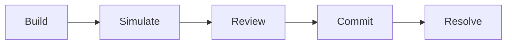

Aomi is execution infrastructure: it takes an intent from an agent or app and turns it into a transaction that lands onchain. A model is good at working out what you want and bad at producing calldata you should sign blind, so Aomi splits those jobs. The model picks operations and arguments. The runtime builds the transaction, simulates it against live chain state, gets it signed under the wallet's policy and broadcasts it. Simulation is the gate in the middle of that pipeline, not the whole product.

## The pipeline

Every execution moves through the same stages, in order:

| Stage | What happens | What comes out |
| --- | --- | --- |
| Build | An App operation or the caller assembles an ordered list of actions. | A Build with `status: "staged"` or `"simulated"` |
| Simulate | Aomi runs those exact actions, in that order, against current chain state. | Balance changes, approvals, fees, warnings, guard results, gas and logs |
| Review | Your app or the portal shows the actions and the evidence. | A decision from the user or a policy they set |
| Commit | Aomi checks the Build is the one that passed simulation and hasn't expired. | `status: "committed"` plus typed signing requests |
| Resolve | A wallet or authorized signer answers each request. | Submitted transactions, signatures or a rejection |

A Build carries an expiry, a digest and a server attestation. You pass it between stages unchanged. Nothing later in the pipeline can swap the target, value, calldata, instruction bytes or order of what was simulated.

That gives the rule the rest of Aomi depends on: **an action that fails simulation does not cross the signing boundary.** If simulation fails, the fix is a new Build, not a retry.

## Simulation on a fork

Simulation runs on a fork of the target chain. It reports balance changes, gas and revert reasons without spending gas or touching the real chain. Multi-step flows are simulated together, so a swap sees the approval that comes before it.

Simulation also catches drain vectors. If a recipient field such as `recipient` (Uniswap), `onBehalfOf` (Aave), `mintRecipient` (CCTP) or `_to` (OP Stack bridges) doesn't match the signer, the transaction is blocked before anyone is asked to sign.

On Solana, ordered instructions go into one atomic transaction instead of an EVM batch. The Pipeline API has Solana `simulate` routes, but the portal currently sends Solana requests to the wallet without a fork simulation. Check those in the wallet prompt.

## Two ways in: Agent and Pipeline

The same runtime serves two APIs.

**Agent** (`/v1/agent`) owns conversation state. You send a prompt, the agent plans, calls tools and streams events. When it reaches the signing boundary it emits an `action` event. Use it when you want Aomi to plan from a goal.

**Pipeline** (`/v1/pipeline`) is stateless. You discover an App's operations, then drive build, simulate and commit yourself. Use it when you already know the exact operation.

The [SDK](/reference/sdk), [CLI](/reference/cli) and [MCP servers](/reference/mcp-tools) all sit on top of these two.

## What runs on Aomi, not on your side

The runtime handles dispatch, a separate agent thread per user, model and tool scheduling, chain forks and session storage. Your Apps add tools and a preamble on top. They don't run their own servers for the agent loop.

Apps ask for chain capabilities through host namespaces, for example `evm-reads` for read calls or `evm-sim` for staging and simulation without commit. Asking for a namespace makes those tools visible. It does not grant signing authority. See [Apps and routing](/concepts/apps).

## Related

- Who is allowed to sign, and how that's enforced: [Signing and permissions](/concepts/permission-model)
- The endpoints behind each stage: [API reference](/reference/api)
