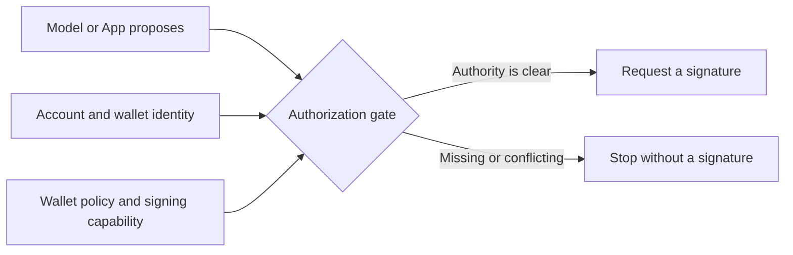

Aomi treats model output as a proposal. A prompt, an App or a skill can ask for a transaction. None of them can give themselves permission to sign it. That decision belongs to the wallet's policy, and it holds the same way in chat, in scheduled work and inside an embedded widget.

## Who controls what

| Actor | Controls | Can't |
| --- | --- | --- |
| You | Wallet connections, signing policy, approvals, revocation | Change policy without proving control of an authorized wallet |
| Model | The proposed intent and tool calls | Set its own signing mode or produce a signature |
| App and skills | Which tools the model has and their constraints | Override the wallet's policy |
| Aomi runtime | Evaluating policy and routing to the allowed signing path | Use a self-custody key, which stays in your wallet |
| Wallet or provider | The cryptographic signature | Sign more than it was asked to sign |

Your Aomi account owns threads, settings, Apps and policy records. Each linked wallet stays a separate signing identity. Linking a second wallet doesn't merge funds, keys or permissions.

## Three separate checks

A transaction only reaches a signer when all three pass. Passing one says nothing about the others.

**Signing policy** decides what kind of approval a wallet needs: you approve every time, an authorized path may sign, or signing is blocked. In the portal these are Manual, Accept transactions, Bypass permissions and Locked. A policy belongs to one wallet.

**Signing capability** is whether that path actually exists right now. A policy can allow unattended signing, but if the Privy delegation or Para agent wallet isn't authorized for that exact wallet, Aomi stops. It never substitutes another signer.

**Transaction constraints** are the guards: App allowlists of contracts, selectors and spenders, protocol drain-vector checks, per-call value caps and read-only threads. Anything a guard can't decode fails closed.

## Aomi never holds your private keys

Keys and funds stay with you. In the portal your wallet signs. In the CLI, `aomi tx sign` signs locally on your machine with viem, the same library most wallets use. If an agent runs that command, the agent is pressing Sign with whatever key it was given, so keep keys away from agents you don't control.

MCP and OAuth follow the same line. A grant lets a client call Aomi. It never hands over a key or a reusable signature.

## Related

- The stages a transaction goes through: [How Aomi works](/concepts/how-aomi-works)
- Setting a policy in practice: [Trade in the portal](/guides/portal#choose-a-signing-policy)
